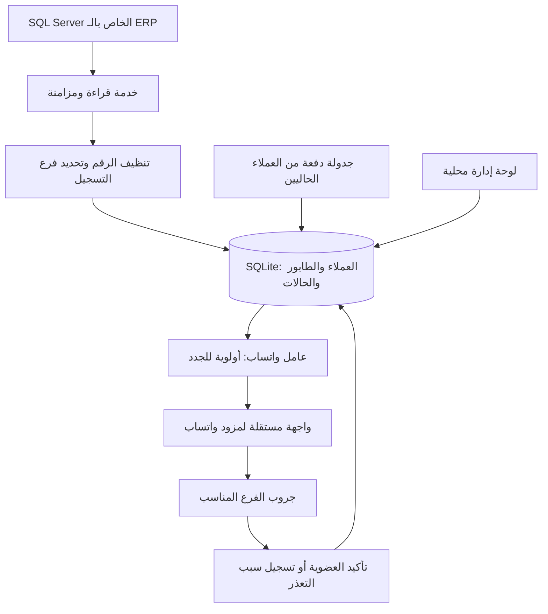

# دراسة ربط ERP الروضة بجروبات واتساب

تاريخ المراجعة: 30 أكتوبر 2026، بتوقيت القاهرة.

## المطلوب المؤكد

- الخادم الرئيسي يعمل على Windows ويخدم 9 فروع.
- يوجد نحو 200 عميل جديد يوميًا إجمالًا؛ هذا تقدير من صاحب النظام وليس قياسًا من النسخة.
- توجيه العميل إلى فرع تسجيله، وليس الاستنتاج من آخر فاتورة.
- تأكدت قائمة الفروع التسعة من صاحب النظام؛ معرفاتها: 39، 40، 41، 42، 45، 51، 56، 57، 60 في البرنامج 9.
- العملاء الحاليون يُعالَجون على دفعات يومية، والجدد لهم أولوية.
- إرسال الرسائل الشخصية ميزة مؤجلة؛ إرسال دعوة خاصة يحتاج إعدادًا واضحًا أيضًا.
- أكد صاحب النظام أن العملاء يُبلّغون ويوافقون وقت أخذ أرقامهم على إضافتهم مباشرة إلى جروب الفرع. هذه هي آلية الموافقة المعتمدة، ولا يتطلب التشغيل سؤال العميل مرة أخرى.

## نتيجة فحص قاعدة البيانات الفعلية

تم فتح **نسخة مستقلة** من ملفي MDF/LDF داخل SQL Server 2022 معزول عن الشبكة، ثم جعل قاعدة الفحص للقراءة فقط. ترقية تنسيق الملفات حدثت على النسخة المؤقتة فقط. الأرقام أدناه تخص الملفات المرفقة وليست قياسًا لقاعدة الفروع الحية.

- `dbo.person`: عدد السجلات **6,999**؛ ليست كلها عملاء.
- المفتاح الأساسي: `(idprogramitems, idbranch, idperson)`. يوجد **1,234** قيمة `idperson` مستخدمة في أكثر من فرع داخل البرنامج 9؛ الاعتماد على رقم الشخص وحده يخلط سجلات فعلية.
- نوع الشخص من `dbo.kindperson` عبر البرنامج والفرع والنوع معًا. مثلًا نوع العميل في المنصوره `49` وفي سنتر الجديدة `53`، بينما `53` في عمر افندي يعني مندوبًا؛ لا يصلح شرط ثابت مثل `idkindperson=1` أو ربط النوع وحده.
- `person.idbranch` مرتبط بالفرع؛ اسم الفرع من `dbo.branchmain`، وإعداد الفرع لكل برنامج من `dbo.branch`.
- بيانات النشاط الأساسية موجودة في البرنامج `idprogramitems=9` واسمه `Emoji Store`: **6,919** سجلًا مصنفًا «عميل». إجمالي المصنفين «عميل» عبر كل البرامج **6,948**، لذا يجب تحديد البرنامج أيضًا.
- الهاتف في `ftel1` إلى `ftel4`، والاستخدام الأساسي لـ`ftel1`.
- ضمن البرنامج 9: **6,520** عميلًا لديهم رقم واحد على الأقل يطابق شكل موبايل مصري بعد التنظيف؛ **6,263** رقمًا مختلفًا عبر الحقول. هذا فحص شكل فقط، وليس إثبات أن الرقم على واتساب أو يخص العميل.
- **399** عميلًا بلا موبايل مصري مطابق للفحص؛ منهم **242** جميع حقول هواتفهم فارغة. الباقون يحتاجون مراجعة، وقد تتضمن القيم هواتف أرضية أو صيغًا لم يعالجها الفحص؛ لا نحذفهم باعتبارهم غير صالحين.
- **243** رقم موبايل مشترك بين أكثر من سجل عميل؛ **79** منها تظهر في أكثر من فرع. هناك **8** عملاء لديهم أكثر من رقم موبايل مختلف. نحتاج سياسة واضحة لهذه الحالات قبل الإدخال الجماعي.
- **لا يوجد** حقل إنشاء/تعديل أو `rowversion` في `dbo.person`، وChange Tracking غير مفعّل على أي جدول بالنسخة. لذلك لا يمكن تقديم «اسحب ما بعد آخر تاريخ» على هذا المخطط. للنسخة التجريبية نقرأ الحقول المحدودة ونقارنها محليًا؛ لتشغيل طويل المدى نقيّم Change Tracking مع مسؤول ERP.
- لا يحتوي جدول الأشخاص في المخطط المفحوص على علامة حذف مباشرة؛ توجد علامات إخفاء منها `fhid`. معناها التشغيلي وقواعد الحذف/الإخفاء تُراجع مع ERP ولا تُفترض من الاسم وحده.

تعريفات الفروع في النسخة أكثر من الفروع التسعة التي ذكرها صاحب النظام؛ تفعيل الفرع في النسخة ليس إثباتًا أنه يعمل الآن. هذه إحصاءات البرنامج 9 حسب التصنيف «عميل»، قبل اختيار الفروع التشغيلية:

| كود الفرع | الاسم المخزن | عدد العملاء | ملاحظة تعريف الفرع |
|---|---|---:|---|
| 1 | المركز الرئيسى | 39 | ظاهر في النسخة |
| 39 | المنصوره | 3,420 | ظاهر في النسخة |
| 40 | كفر سعد | 18 | ظاهر في النسخة |
| 41 | عمر افندي | 306 | ظاهر في النسخة |
| 42 | سنتر الجديدة | 1,234 | ظاهر في النسخة |
| 44 | المنصورة | 0 | غير ظاهر |
| 45 | الزرقا | 22 | ظاهر في النسخة |
| 51 | شربين | 712 | ظاهر في النسخة |
| 56 | النخلة | 687 | ظاهر في النسخة |
| 57 | عمر افندي 2 | 254 | ظاهر في النسخة |
| 58 | سبينس | 2 | ظاهر في النسخة |
| 59 | اون لاين | 5 | ظاهر في النسخة |
| 60 | فارسكور | 220 | ظاهر في النسخة |
| 61 | ف | 0 | محذوف |

أكد صاحب النظام الفروع التسعة: المنصوره (39)، كفر سعد (40)، عمر افندي (41)، سنتر الجديدة (42)، الزرقا (45)، شربين (51)، النخلة (56)، عمر افندي 2 (57)، وفارسكور (60). نطاق التشغيل إذًا هو البرنامج 9 وهذه المعرفات فقط، ويضم **6,873** سجل عميل في النسخة؛ **6,518** منهم لديهم موبايل مصري مطابق للفحص، و**355** يحتاجون مراجعة الأرقام. المركز الرئيسي وسبينس وأون لاين وباقي التعريفات خارج النطاق. يجب تحديد الجروبات الفعلية وحساب/حسابات الإدارة قبل التشغيل.

ملفات المراجعة: `docs/database-profile.json` به إحصاءات مجمعة دون أسماء العملاء أو أرقامهم، و`scripts/inspect_erp.sql` لاستكشاف المخطط، و`scripts/read_customers.sql` لاستعلام مصدر العملاء. الاستعلام الأخير يُخرج بيانات شخصية عند تشغيله، فيُحفظ محليًا.

## القرار المقترح

تطبيق مستقل بجوار ERP، يتصل بـSQL Server ويحتفظ بقاعدة تشغيل منفصلة. لا يقرأ ملف MDF المفتوح مباشرة، ولا يراقب وقت تعديل الملف، ولا يرسل طلبات واتساب من SQL Trigger.

البدء بـTypeScript/Node.js لخدمة المزامنة ولوحة إدارة محلية، وSQLite لطابور العمل والحالات. ربط واتساب خلف واجهة قابلة للاستبدال. لا حاجة إلى Redis أو PostgreSQL لمجرد معالجة 200 عميل يوميًا على جهاز واحد.

ترشيحي للنسخة الأولى على Windows هو whatsapp-web.js مباشرة خلف واجهة مستقلة: تحكم أدق في الدعوات والنتائج، ونشر أبسط دون بوابة إضافية. يظل الاختيار مشروطًا بتجربة ربط وإضافة فعلية بأرقام اختبار. OpenWA بديل مناسب إذا احتجنا لوحة إدارة جلسات جاهزة وHTTP API، مع تعديل سلوك الدعوات الموضح أدناه. دعم 9 فروع لا يفرض 9 جلسات؛ العدد يتوقف على أرقام الواتساب التي ستدير الجروبات.

تحديث التجربة في 30 أكتوبر 2026: تم ربط الحساب وقراءة الجروبات وفحص العضوية والأدمن، وأكد صاحب النظام أن إضافة الشخص تمت فعليًا. عولج خطأ توافق قراءة الجروبات بمحول محدود داخل الاختبار. إنشاء جروب ومشاركة سجل الرسائل الأصلي لم يتم اختبارهما فعليًا بعد.

## تصميم إدارة الجروبات والانضمام وسجل الرسائل

أكد صاحب النظام أن المطلوب هو رؤية الرسائل السابقة **داخل سجل الجروب نفسه**؛ إرسال رسائل خاصة ليس بديلًا معتمدًا لهذا الطلب.

### تقليل مخاطر تقييد الحساب

نجاح إضافة فرد في تجربة لا يثبت سماح واتساب بإضافة 200 عميل يوميًا. لا يوجد حد يومي أو فاصل زمني يضمن عدم التقييد عبر مكتبة غير رسمية. توثيق واتساب يحذر من الإضافات والرسائل غير المرغوبة والأتمتة غير المصرح بها.

- يعتمد التشغيل على إجراء التسجيل الذي أكده صاحب النظام: العميل يعرف ويوافق على إضافته وقت أخذ رقمه. يدخل العميل الجديد طابور الإضافة مباشرة بعد اكتمال الرقم والفرع؛ لا توجد رسالة موافقة إضافية أو خطوة تأكيد أخرى للعميل. يسجل النظام مصدر الموافقة باعتباره إجراء التسجيل المعتمد، ولا يختلق تاريخ موافقة تاريخيًا غير موجود في ERP.
- الإضافة المباشرة هي المسار الأساسي المتفق عليه. يمكن توفير QR أو رابط انضمام كمسار اختياري لحالات تعذر الإضافة، دون جعله شرطًا لكل العملاء أو إرسال دعوات خاصة تلقائيًا قبل ضبط سياسة الدعوات.
- عامل واحد متسلسل لكل حساب، بحدود تشغيل قابلة للتعديل وأوقات عمل معلنة؛ الإنشاء والإضافة وأي رسائل مستقبلية تدخل ميزانية التشغيل نفسها. لا توصف هذه الحدود بأنها آمنة أو معتمدة من واتساب.
- وقف الأعمال الجديدة عند ظهور تقييد صريح، أو فشل تقني متكرر يمنع التأكد من النتائج، مع تنبيه المشغل وسبب الوقف. العطل التقني لا يُصنّف تلقائيًا باعتباره بانًا.
- الخصوصية، ومغادرة العميل، وطلب عدم التواصل حالات تمنع إعادة المحاولات التلقائية. إعادة الإضافة اليدوية المتاحة في الاختبار ليست سياسة تشغيل جماعي.
- حدث المغادرة ليس بلاغًا، ولا يثبت أن الحساب تعرض لتقييد. يسجل كحالة `left` تمنع إعادة الإدخال التلقائي. إذا طلب العميل العودة صراحة، يسمح النظام بمسار إعادة انضمام يدوي أو رابط وفق ما يسمح به واتساب؛ لا تتحول المغادرة إلى منع دائم. طلب عدم التواصل يسجل منفصلًا ويظل نافذًا حتى يغيّر العميل طلبه.
- مراجعة العضوية بعد كل عملية، والتدارك قبل إعادة عملية غير مؤكدة، ومنع التكرار بين سجلات ERP التي تشترك في رقم واحد وفق سياسة الفروع.
- لا توفر المكتبة سجلًا كاملًا مضمونًا لكل بلاغات المستخدمين؛ لا تعرض لوحة الإدارة «نسبة أمان» أو غياب بلاغات على أنه دليل سلامة الحساب.

### امتلاء جروب الفرع وفتح جروب جديد

حد جروبات التطبيق العادية الوارد في مركز مساعدة واتساب هو 1,024 عضوًا. تضبط لكل فرع عتبة سعة تشغيلية أقل مع هامش للأدمن والإضافات اليدوية؛ مثل 950 عضوًا كإعداد تنظيمي أولي، وليس حدًا مرتبطًا بمنع البان.

المكتبة المنشورة 1.34.7 تحتوي `Client.createGroup()` وخيارات لإعداد الجروب، لكن وجود الدالة لا يثبت نجاحها على إصدار واتساب الحالي؛ يلزم اختبار إنشاء مستقل. نتيجة الإنشاء تتضمن معرف الجروب ونتائج المشاركين؛ لا تُعتبر الإضافات ناجحة لمجرد إنشاء الجروب.

سير العمل المقترح:

1. لكل فرع جروب يستقبل الجدد، ويمكن تجهيز جروب احتياطي مسبقًا بأسماء مثل «الروضة — المنصوره — 02».
2. تُقرأ العضوية الحية قبل حجز مكان، ويُحسب الهامش مع عمليات الإضافة المحجوزة لمنع تجاوز السعة بسبب التزامن.
3. عند بلوغ العتبة يتوقف استقبال الجدد في الجروب الحالي، وتستمر عضوية أعضائه؛ لا يُنقل العملاء تلقائيًا.
4. يُفعّل الاحتياطي الجاهز. إذا لم يوجد، تُنشأ مهمة إنشاء واحدة تحت قفل الفرع، ثم يراجع النظام المعرف والإعدادات والأدمن قبل تفعيل الجروب.
5. يُنشأ الجروب بحساب الإدارة والمشاركين الإداريين المتفق عليهم، دون إدخال دفعة عملاء ضمن طلب الإنشاء ودون دعوات خاصة تلقائية.
6. إذا فشل الإنشاء أو كانت نتيجته غير مؤكدة، تنتظر الإضافات ويُطلب فحص الحالة؛ لا تُنشأ جروبات متكررة عميانيًا. لا يجري إنشاء بديل عندما يكون الحساب مقيدًا.
7. حالات الجروب الداخلية: `provisioning`, `reserve`, `accepting`, `closed_to_new_members`, `needs_review`. الإغلاق أمام الجدد لا يعني حذف الجروب أو أرشفته على هواتف العملاء.

في البداية تُنشأ الجروبات الاحتياطية بإجراء واضح من الإدارة، ثم يمكن اعتماد الإنشاء التلقائي بعد اجتياز اختباره. لا يعتمد التشغيل على نجاح إنشاء جروب في اللحظة التي يصل فيها عميل جديد.

### ظهور الرسائل السابقة للعضو الجديد داخل الجروب

واتساب أعلن ميزة Group Message History في فبراير 2026. مركز المساعدة يوضح إمكانية مشاركة حتى 100 رسالة من آخر 14 يومًا عند إضافة عضو، بحسب توفر الخيار وإعداداته. المشاركة إجراء صريح، ويظهر تنبيه في الجروب عند مشاركة السجل؛ ليست كل الرسائل القديمة متاحة تلقائيًا لكل من ينضم.

فحص كود `whatsapp-web.js@1.34.7` المثبت وواجهاته لم يجد دالة أو خيارًا جاهزًا لمشاركة هذا السجل الأصلي مع عضو جديد. `syncHistory()` يخص مزامنة المحادثة للجلسة المرتبطة، ولا يثبت دعم مشاركة السجل إلى عميل جديد. قراءة الرسائل أو إعادة إرسالها رسائل جديدة لا تحقق شرط رؤية السجل الأصلي.

لذلك يُفصل دعم السجل عن نجاح الإضافة:

- مهمة الانضمام تؤكد العضوية أولًا.
- مهمة السجل تشير إلى العضو والجروب وعملية الانضمام المطلوبة، وتتحقق من توفر القدرة الفعلية وحدود السجل قبل التنفيذ.
- حالات السجل: `not_requested`, `unsupported`, `pending`, `shared_confirmed`, `failed`, `outcome_unknown`. لا تُسجّل «تمت المشاركة» بناءً على نجاح الإضافة أو تبديل إعداد السماح بمشاركة السجل.
- عند غياب التكامل الآلي، تعرض اللوحة إجراء مشاركة يدويًا إذا كان متاحًا في التطبيق؛ لا تتحول تلقائيًا إلى رسائل خاصة.
- اختبار القبول يحتاج عضو اختبار جديدًا يتأكد من رؤية رسائل كانت موجودة قبل دخوله **داخل الجروب نفسه**، بما فيها رسالة نصية وصورة عند الحاجة. رؤية الأدمن للسجل أو نجاح استدعاء مزامنة ليسا إثباتًا.
- عند فتح جروب جديد لا ينتقل إليه سجل الجروب السابق تلقائيًا. يمكن نشر عروض الفرع السارية فيه كمحتوى جديد متفق عليه، ويظل هذا مختلفًا عن نقل السجل القديم.

بعض بوابات واتساب توفر إعداد «من يمكنه مشاركة السجل»؛ هذا إعداد صلاحيات فقط ولا يثبت وجود عملية إرسال السجل إلى عضو معين. لا نغيّر المكتبة أو البوابة اعتمادًا على هذا الإعداد وحده.

### بيانات التشغيل الضرورية

| السجل | الغرض |
|---|---|
| `branches` | الفروع التسعة وربط معرفات ERP والإعدادات التشغيلية |
| `customers` و`customer_phones` | مفاتيح ERP المركبة والأرقام الموحدة وتعارضات الأرقام |
| `consents` | موافقة الانضمام ومصدرها وسحبها |
| `whatsapp_accounts` | حالة الجلسة والصلاحيات والوقف التشغيلي |
| `branch_groups` | معرف الجروب وتسلسله وسعته وحالة استقبال الجدد |
| `memberships` | العضوية الفعلية وآخر تحقق والمغادرة والمنع |
| `jobs` و`job_attempts` | الإضافة والإنشاء ومشاركة السجل والحجوزات والنتائج غير المؤكدة |
| `history_shares` | حالة مشاركة السجل لكل انضمام وإثبات النجاح عند توفره |

ترتيب التنفيذ التالي: اختبار إنشاء جروب مستقل، ثم اختبار مشاركة السجل الأصلي كشرط تقني منفصل، ثم تطبيق الطابور الدائم والموافقات وإدارة سعة الجروبات، ثم التوسع من فرع واحد. الأسئلة الحالية لم تُستخدم لإنشاء جروب أو إرسال سجل رسائل فعليًا.

## سير البيانات

## التقاط العملاء الجدد

1. أول تشغيل يأخذ خط أساس للعملاء الحاليين ويضعهم في مسار الدفعات؛ لا يعامل الجميع كعملاء جدد.
2. فحص كل 5–10 ثوانٍ هدف مبدئي لزمن اكتشاف العميل، وليس ضمانًا لزمن إدخاله الجروب.
3. الاختيار الأول للفحص التجريبي اتصال بصلاحيات قراءة فقط. نعتمد طريقة القراءة على الأعمدة والفهارس التي يؤكدها الفحص.
4. لا نعتمد على `MAX(id)` وحده: قد تكون المفاتيح GUID أو تحدث عمليات حفظ متزامنة، وقد يسجل العميل قبل إدخال موبايله أو فرعه. يلزم التقاط التعديلات أيضًا.
5. إذا لم يوجد مؤشر موثوق للتعديل، يمكن مزامنة الحقول الضرورية ومقارنتها محليًا، بفاصل يناسب الحجم والحمل، مع فحص دوري شامل للتدارك. لا نعتمد فحصًا كاملًا متكررًا قبل قياس تكلفة الاستعلام.
6. بديل التشغيل طويل المدى هو SQL Server Change Tracking إن كانت الجداول مناسبة ويمكن تفعيله باتفاق مسؤول الـERP. يحتاج مفتاحًا أساسيًا وإعدادًا على القاعدة والجداول. يتطلب حفظ إصدار المزامنة، وفحص صلاحية الإصدار مقابل الاحتفاظ، وإعادة التهيئة عند انتهاء المدة.
7. حفظ الأحداث المحلية ومؤشر المزامنة يكون ذريًا قدر الإمكان. عند إعادة قراءة حدث، يمنع القيد الفريد تكرار المهمة.
8. لا نستخدم `NOLOCK` لاكتشاف العملاء: لا نريد التصرف على بيانات غير مثبتة. الاستعلامات قصيرة ومحددة، ويُقاس أثرها على أداء ERP.

## قواعد الأرقام والفروع

- الاحتفاظ بقيمة الهاتف الأصلية مع نسخة موحدة بصيغة دولية؛ تحويل الأرقام العربية وإزالة التنسيق ومعالجة بادئة مصر بشكل صحيح. لا نخمن أرقامًا ناقصة.
- عدم اعتبار كل شخص في جدول الأشخاص عميلًا؛ نستخدم علاقة/نوع العميل الفعلي بعد التحقق من المخطط.
- إذا وُجدت عدة أرقام في السجل، نعرض التعارض ولا نضيفها كلها تلقائيًا.
- العميل بلا رقم أو بلا فرع يظل معلقًا حتى تُستكمل البيانات.
- تكرار رقم الهاتف بين أكثر من عميل يحتاج منع تكرار الإضافة، مع حفظ ارتباطات سجلات ERP.
- المفتاح التنفيذي المقترح للعضوية: `(whatsapp_account_id, group_id, normalized_phone)`؛ سياسة الانضمام لأكثر من فرع تُحسم صراحة عند تعارض التسجيلات.
- ربط معرف الفرع الحقيقي بمعرف جروب واتساب، لا الاعتماد على تطابق الأسماء.
- يمكن لكل فرع أن يملك أكثر من جروب عند امتلاء الجروب؛ السعة إعداد يُراجع مع بيانات واتساب الحية.
- تعديل فرع العميل بعد إضافته لا يسبب نقلًا أو إزالة تلقائية في النسخة الأولى؛ يُسجّل للمراجعة.

## الطابور والتشغيل

- عامل تنفيذ محدود لكل حساب واتساب، مع حجز المهمة ومدة صلاحية للحجز لمنع التنفيذ المتزامن.
- الجدد أعلى أولوية، والعملاء الحاليون لهم حصة يومية قابلة للضبط، ضمن الميزانية المشتركة للحساب. لا يوجد رقم يومي يضمن عدم تقييد الحساب.
- يُعاد فحص الفرع والرقم وحالة العميل قبل التنفيذ، لأن بياناته قد تتغير أثناء الانتظار.
- فصل الحالات: `pending`, `waiting_for_data`, `already_member`, `joined`, `invite_required`, `invite_sent`, `not_on_whatsapp`, `invalid_phone`, `group_full`, `retry_later`, `outcome_unknown`, `opted_out`, `manual_review`.
- `invite_sent` لا يساوي `joined`؛ تأكيد الانضمام يأتي من حدث عضوية أو إعادة قراءة أعضاء الجروب.
- في مهلة اتصال أو انقطاع بعد الطلب، تُراجع العضوية قبل الإعادة؛ النجاح مرة واحدة لا يمكن ضمانه عبر نظام خارجي بمجرد معاملة SQLite.
- إعادة المحاولة للأخطاء المؤقتة بتأخير متزايد وحد أقصى؛ الخصوصية أو مغادرة العميل ليست سببًا لإعادة الإضافة المتكررة.
- انقطاع جلسة واتساب يوقف التنفيذ ويُظهر تنبيهًا، بينما تستمر مزامنة ERP والطابور إن كان الاتصال متاحًا.
- مغادرة الجروب أو طلب عدم التواصل يمنع إعادة الإضافة تلقائيًا.
- موافقة العميل على دخول جروب مأخوذة ضمن إجراء التسجيل المعتمد حسب تأكيد صاحب النظام؛ لا يضيف النظام طلب موافقة آخر. يظل طلب عدم التواصل أو المغادرة اللاحقة سببًا لإيقاف الإضافة التلقائية.

## ملاحظات مؤكدة من مراجعة OpenWA

المستودع المقترح هو `rmyndharis/OpenWA`، وليس مشروعًا آخر يحمل اسم open-wa. بوابة مستقلة ذات REST API ولوحة إدارة وجلسات متعددة، وتدعم محركي whatsapp-web.js وBaileys.

في كود محرك whatsapp-web.js الذي تمت مراجعته:

- `addParticipants` يستدعي المكتبة دون تمرير خيارات الإضافة.
- المكتبة تجعل `autoSendInviteV4=true` افتراضيًا؛ قد ترسل دعوة خاصة عندما تمنع الخصوصية الإضافة المباشرة.
- البوابة تعتبر نتيجة `403` مع `isInviteV4Sent=true` نجاحًا. لذلك يجب تفسير حالة كل مشارك، لا الاكتفاء بـHTTP 200 أو `success=true`.
- واجهة `ParticipantsDto` التي تمت مراجعتها لا تتيح خيار تعطيل الدعوة. إذا اعتمدنا هذا المسار يلزم تعديل صغير واختباره، أو استخدام المحرك مباشرة مع `autoSendInviteV4:false` في المرحلة التي لا ترسل دعوات.
- `createGroup` في هذا المحرك يرفض العملية بـ`EngineNotSupportedError` في النسخة المراجعة، رغم وجود إنشاء جروبات على مستوى واجهة البوابة. البداية تكون بجروبات مُنشأة مسبقًا، أو اختبار محرك مختلف إذا احتجنا الإنشاء الآلي لاحقًا.

هذه قراءة كود وتوثيق؛ لم يتم ربط حساب واتساب أو إضافة عملاء أو إرسال رسائل أثناء الدراسة.

## مقارنة الاختيارات

| الاختيار | دوره | ملاءمته هنا |
|---|---|---|
| OpenWA | بوابة جاهزة بمحرك قابل للاختيار ولوحة جلسات | بديل مناسب إذا احتجنا بوابة مستقلة، مع ضبط الدعوات والحالات وتثبيت نسخة مجرّبة |
| whatsapp-web.js مباشرة | مكتبة Node.js تستخدم متصفحًا | الاختيار المقترح للنسخة الأولى للتحكم الدقيق والنشر المحلي؛ علينا بناء إدارة الجلسات والأخطاء |
| Baileys مباشرة أو خلف البوابة | مكتبة اتصال WebSocket دون متصفح | أقل اعتمادًا على موارد المتصفح؛ تتطلب اختبار توافق الجلسات والأحداث والإضافات، ولا تضمن سلامة الحساب |
| Meta Cloud API | المسار الرسمي | مناسب لتقييم الرسائل الفردية لاحقًا. Groups API الحالي يشترط OBA، وحده 8 مشاركين والدخول بدعوة، فلا يطابق جروبات الفروع الكبيرة |

كل محركات واتساب غير الرسمية معرضة لتغييرات واتساب وتقييد الحساب؛ لا يوجد ضمان أن تأخير الطلبات يجعل إضافة 200 شخص يوميًا آمنة. البداية بحساب مخصص وتجربة صغيرة مع عملاء وافقوا على الانضمام.

## النشر على Windows

- خدمة تبدأ تلقائيًا مع الجهاز وتتعافى من التعطل، بحساب تشغيل محدود.
- مجلد بيانات ثابت محمي بصلاحيات Windows للجلسات وقاعدة SQLite؛ نسخ احتياطي متسق للبيانات والإعدادات.
- لوحة إدارة محلية مع تسجيل دخول؛ إتاحة الفروع عبر الشبكة الداخلية حسب الحاجة، لا فتح SQL Server أو واجهة واتساب للإنترنت.
- صلاحيات SQL على الجداول المطلوبة فقط؛ أسرار الاتصال والجلسة لا تدخل Git أو سجلات التشخيص.
- عدم جعل Docker Desktop متطلبًا مسبقًا قبل مراجعة مواصفات وإصدار Windows؛ يمكن تشغيل Node.js والخدمات مباشرة. SQL Server المستخدم للفحص هنا معزول عن الـERP الفعلي.

## نطاق النسخة الأولى

1. تأكيد مخطط العملاء والفروع وجودة الأرقام على النسخة المحلية.
2. عرض العملاء وربط الفروع بالجروبات، وربط حساب اختبار.
3. تشغيل مزامنة وطابور في وضع معاينة بدون أي طلبات إضافة أو إرسال.
4. تجربة محدودة تشمل: عميل جديد، رقم استُكمل لاحقًا، فرع استُكمل لاحقًا، رقم مكرر، عضو موجود، منع الخصوصية، جلسة مفصولة، وطلب انتهى بمهلة بعد احتمال نجاحه.
5. تشغيل فرع واحد، ثم التوسع للفروع التسعة بعد مراجعة النتائج.
6. تفعيل دفعات العملاء الحاليين بالإعدادات المتفق عليها، ثم دراسة الرسائل الفردية كمرحلة مستقلة.

القياسات الأساسية: وقت اكتشاف العميل، عدد المنتظرين لكل فرع، الانضمامات المؤكدة، الدعوات، أسباب التعذر، وحالة الاتصال. المطلوب تجاريًا 200 عميل جديد/يوم؛ نجاح المزامنة بهذا الحمل لا يضمن سماح واتساب بإضافتهم كلهم.

## مصادر المراجعة

- [OpenWA: المشروع والتشغيل والمحركات](https://github.com/rmyndharis/OpenWA)
- [OpenWA: تنفيذ الجروبات في محرك whatsapp-web.js](https://github.com/rmyndharis/OpenWA/blob/main/src/engine/adapters/wwebjs-groups.ts)
- [OpenWA: مدخلات API لإضافة المشاركين](https://github.com/rmyndharis/OpenWA/blob/main/src/modules/group/dto/group.dto.ts)
- [whatsapp-web.js: خيارات الإضافة والنتائج](https://docs.wwebjs.dev/structures_GroupChat.js.html)
- [Baileys: المستودع الرسمي](https://github.com/WhiskeySockets/Baileys)
- [Meta: Groups API](https://developers.facebook.com/documentation/business-messaging/whatsapp/groups/)
- [Meta: مرجع الجروبات وعدم الإضافة اليدوية](https://developers.facebook.com/documentation/business-messaging/whatsapp/groups/reference)
- [Microsoft: تشغيل Change Tracking](https://learn.microsoft.com/en-us/sql/relational-databases/track-changes/enable-and-disable-change-tracking-sql-server/)
- [Microsoft: مزامنة Change Tracking وصلاحية الإصدارات](https://learn.microsoft.com/en-us/sql/relational-databases/track-changes/work-with-change-tracking-sql-server)
- [WhatsApp: الاستخدام المسؤول وطلب الإذن قبل الإضافة](https://faq.whatsapp.com/361005896189245/?locale=en_US)
- [WhatsApp: سعة الجروبات ومشاركة سجل حديث عند الإضافة](https://faq.whatsapp.com/841426356990637/?cms_platform=iphone&locale=en_US)
- [WhatsApp: إعلان Group Message History](https://blog.whatsapp.com/introducing-group-message-history-a-more-private-way-to-catch-up-in-group-chats)
- [whatsapp-web.js: إنشاء الجروبات](https://docs.wwebjs.dev/Client.html#createGroup)
- [WAHA: إعداد صلاحيات مشاركة السجل](https://waha.devlike.pro/docs/how-to/groups/#security---share-message-history-with-new-members)

## تحديث بعد التجربة الفعلية — 30 أكتوبر 2026

وصف الدراسة الأولية أعلاه يخص وقت فحص الكود. أُجريت لاحقًا تجربة مفوضة: إنشاء جروب جديد والإضافة إليه نجحا مع تحقق الحالة. مشاركة السجل القديم فشلت عند بوابة إرسال واتساب رغم نجاح فحص أهلية ما بعد الانضمام. الوسائط واجهت خطأ توافق ولم تعتمد. المرجع التنفيذي الأحدث هو [خطة التنفيذ](implementation-plan.ar.md)، وتفاصيل الدليل في [سجل التجربة](whatsapp-test.ar.md).
